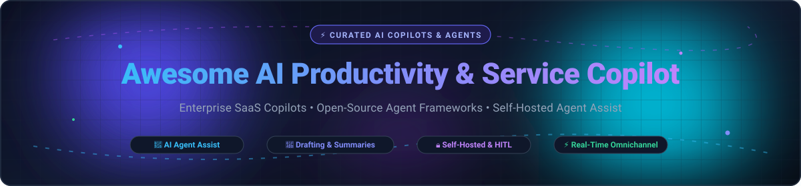

  

# Awesome AI Productivity & Service Copilot 🤖✨

  
  
  
  
  

> 🌟 **A curated directory of top AI Productivity & Service Copilots, Autonomous Support Agents, and Real-Time Agent Assist Frameworks.**  
> *Covering enterprise SaaS copilots, self-hosted omnichannel platforms, procedural knowledge generation, and open-source Human-in-the-Loop (HITL) agent architectures.*

---

## 📌 Table of Contents

- [📊 Sector Overview & Market Dynamics](#-sector-overview--market-dynamics)
- [☁️ SaaS / Hosted Service Copilots](#-saas--hosted-service-copilots)
- [💻 Open-Source GitHub Projects](#-open-source-github-projects)
- [⭐ Star History](#-star-history)
- [🤝 How to Contribute](#-how-to-contribute)
- [☕ Support](#-support)
- [⚖️ Disclaimer](#-disclaimer)

---

## 📊 Sector Overview & Market Dynamics

The AI customer service and real-time agent assist software market is estimated at **$15B–$20B in 2025–2026** (scaling past $140B+ by the mid-2030s at an annual compound growth rate of ~25%). 

The sector displays a distinct bifurcation in market dynamics:
- **Enterprise CRM System-of-Record Layer (Concentrated / Incumbent Dominance):** Core platforms like Microsoft, Salesforce, and Zendesk hold formidable market concentration due to legacy customer databases, unified ticket history, and direct contract bundling.
- **Agent Assist & Intelligent Copilot Layer (Moderately-to-Highly Fragmented):** Point solutions, cross-application desktop overlays, and specialized AI frameworks compete vigorously. Enterprises increasingly mix specialized agent copilots with self-hosted open-source agent engines to retain strict data governance and LLM neutrality.

---

## ☁️ SaaS / Hosted Service Copilots

*Commercial category leaders delivering agent-assist workspaces, context-aware ticket drafting, CRM intelligence, and real-time summarization.*

| Company / Product | Size (Revenue / Valuation) | Pricing (Starting Tier) | Free Tier / Trial Limits | Key Features & Best For |
| :--- | :--- | :--- | :--- | :--- |
| **Microsoft Copilot for Service** | ~$3.1T Market Cap / $245B+ Rev | $50/user/month standalone (or $40/user/month add-on with M365 Copilot; included in Dynamics 365 Customer Service Premium at $135/user/month) | No standalone free plan or trial; 30-day trial available via broader Dynamics 365 Customer Service | Deep CRM integrations (Dynamics 365, Salesforce, ServiceNow), context-aware drafting, real-time call summarization. Best for Microsoft-centric organizations. |
| **Salesforce Einstein Copilot / Agentforce** | ~$280B Market Cap / $38B+ Rev | $165/user/month (Sales Cloud / Service Cloud Enterprise starting tier; Agentforce usage billed separately) | 30-day free trial of Service Cloud (sample data and workflows included); free Developer Edition environment | Native Service Cloud CRM integration, workflow automation, knowledge surfacing. Best for organizations committed to Salesforce CRM. |
| **Zendesk Agent Copilot** | $10.2B Valuation (Acquired) / ~$2B Rev | $50/agent/month add-on below Enterprise (included in Suite Enterprise, which starts at $115/agent/month) | 14-day free trial of Suite Professional (no credit card required; talk limited to 2 min/call, one-time 14-day extension available) | Procedure generation directly from internal sources, Admin Copilot with 70+ proactive workflow recommendations. Best for Zendesk workspace users. |
| **Intercom Copilot** | $3.6B Valuation (Acquired by Salesforce) / ~$400M ARR | $39/seat/month (Essential tier base) + $35/user/month for unlimited Copilot add-on | 14-day free trial of full platform features; paid seats include a permanent free allowance of 10 Copilot conversations/month | Inbox assistant for real-time answer surfacing, message drafting, and translation. Best for teams wanting agent assist integrated alongside Fin AI. |
| **Freshworks Freddy AI Copilot** | ~$3.4B Market Cap / ~$840M Rev | $29/agent/month (Freshdesk Pro annual tier base) + Freddy Copilot add-on | 14-day free trial of Enterprise features; permanent free plan for up to 2 agents (includes 500 free Freddy AI sessions on Pro/Enterprise trial) | Affordable per-seat ticketing copilot, automated draft responses, ticket summarization. Best for cost-conscious support teams. |
| **Ada Copilot** | $1.2B Valuation / ~$70M+ ARR | $30,000/year (~$2,500/month custom entry contract floor; included in Pro, Team, and Enterprise packages) | No free tier; no public self-serve free trial (custom proof-of-concept / evaluation sandboxes available via enterprise sales) | Cross-application desktop overlay driving external tools, automated playbook execution. Best for enterprise multi-channel service centers. |
| **Forethought Assist** | >$200M Valuation (Acquired by Zendesk) / $115M+ Raised | Custom quote-only enterprise contracts (typically starts at ~$50–$100/agent/month platform add-on) | No free tier; no self-serve free trial (offers customized guided Proof of Value / POV pilot using historical support data) | Real-time agent assist alongside Solve and Triage, automated intent routing and macro recommendations. Best for large support teams already using Zendesk/Forethought. |
| **Kustomer KIQ Copilot** | ~$250M Valuation (Spinout from Meta) | $30/user/month standalone copilot add-on (Kustomer platform base starts at $89/user/month Enterprise) | No free tier; no public self-serve free trial (custom sales-led demo and proof-of-concept evaluation available upon request) | Real-time suggested responses, conversation summarization, tone adjustment within CRM. Best for high-volume D2C service operations (>50 tickets/agent/day). |
| **Gladly Sidekick** | ~$415M Valuation / ~$48M ARR | $150/agent/month (Hero entry plan, 10-seat minimum; + $0.25/payment or AI resolution add-ons) | No core free plan; no self-serve free trial for core platform (occasional 30-day trial offered on specific Shopify app store plugins) | Lifelong customer timeline conversation tracking, AI sidekick assistance, chat payments. Best for retail and D2C brands. |
| **LivePerson Copilot** | ~$40M Market Cap / ~$240M Rev | Custom enterprise quote; available strictly on Gold entitlement tier (requires minimum token package commitments) | No free tier; no self-serve free trial (enterprise demonstrations and custom-scoped sandbox pilots available via sales) | Conversational Cloud generative copilot with BYO-LLM integration and automated routing. Best for enterprise contact centers on LivePerson Gold. |

---

## 💻 Open-Source GitHub Projects

*Self-hosted agent assist workspaces, open customer engagement platforms, and programmable LLM agent frameworks. Sorted in descending order by GitHub_Stars.*

1. ### [Dify](https://github.com/langgenius/dify) 
   - **Description**: Open-source LLM app development platform and agent orchestrator. Features visual prompt engineering, multi-model orchestration, Agentic RAG pipelines, and tools for building internal customer support copilot workflows with complete data privacy.
   - **Tech Stack**: Python, TypeScript, Next.js, PostgreSQL
   - **License**: Apache-2.0
   - **Best For**: Engineering teams wanting visual workflow orchestration for customer assist bots, internal agent copilot assistants, and enterprise RAG grounding.

2. ### [Flowise](https://github.com/FlowiseAI/Flowise) 
   - **Description**: Drag-and-drop UI to build customized LLM flows, multi-agent conversational teams, and customer support chatbots. Easily integrates custom enterprise vector stores and APIs as copilot tool plugins.
   - **Tech Stack**: Node.js, TypeScript, LangChain
   - **License**: Apache-2.0
   - **Best For**: Rapid prototyping of customized service copilot flows and agentic tools with zero-code visual nodes.

3. ### [Chatwoot](https://github.com/chatwoot/chatwoot) 
   - **Description**: Leading open-source omnichannel customer support platform (alternative to Zendesk and Intercom). Includes integrated AI assist tools for replying, summarizing tickets, rewriting response tone, and translating multilingual customer chats.
   - **Tech Stack**: Ruby on Rails, Vue.js, PostgreSQL, Redis
   - **License**: MIT
   - **Best For**: Teams needing a turnkey, fully self-hosted agent workspace with native AI assistant features and multi-channel inbox integration (Email, WhatsApp, Telegram, Live Chat).

4. ### [Khoj](https://github.com/khoj-ai/khoj) 
   - **Description**: Open-source AI second brain and personal copilot. Connects with internal documents (PDFs, Markdown, Notion, GitHub) to provide real-time RAG-grounded assistance, proactive suggestions, and context-aware responses.
   - **Tech Stack**: Python, FastAPI, React
   - **License**: AGPL-3.0
   - **Best For**: Support agents and technical teams seeking a self-hosted semantic search and contextual knowledge copilot across disparate internal knowledge bases.

5. ### [Activepieces](https://github.com/activepieces/activepieces) 
   - **Description**: Open-source business automation platform built for AI agentic workflows. Connects customer tickets with 200+ SaaS tools, triggers AI copilot drafting, extracts customer metadata, and syncs data back to CRM backends.
   - **Tech Stack**: TypeScript, Node.js, Angular
   - **License**: MIT / Commercial
   - **Best For**: Automating backend support agent workflows, AI-driven ticket enrichment, and CRM sync.

6. ### [Rasa](https://github.com/RasaHQ/rasa) 
   - **Description**: Enterprise-grade conversational AI platform for building contextual assistants and agentic customer journeys with CalmM (Conversational AI with Language Models), combining LLM reasoning with deterministic business guardrails.
   - **Tech Stack**: Python
   - **License**: Rasa Open Source (Custom/Source Available)
   - **Best For**: Highly regulated enterprises requiring rigorous deterministic guardrails, compliance auditing, and self-hosted on-premise conversational infrastructure.

7. ### [LiveKit Agents](https://github.com/livekit/agents) 
   - **Description**: Framework for building real-time, low-latency multimodal AI agents (voice, video, and text). Designed for real-time contact center voice copilots, live call transcription, and instantaneous speech-to-speech agent assistance.
   - **Tech Stack**: Python, WebRTC, Go
   - **License**: Apache-2.0
   - **Best For**: Engineering teams building next-generation real-time voice copilots and interactive telephone/video support agents.

8. ### [Botpress](https://github.com/botpress/botpress) 
   - **Description**: Modular conversational AI developer platform with natural language understanding, bot visual workflow builder, and multi-channel customer engagement connectors.
   - **Tech Stack**: TypeScript, Node.js
   - **License**: AGPL-3.0
   - **Best For**: Building omnichannel customer-facing chatbots and support agent co-pilots with flexible webhook integrations.

9. ### [Papercups](https://github.com/papercups-io/papercups) 
   - **Description**: Open-source live customer messaging platform with embeddable chat widgets, Slack/Mattermost synchronization, and webhook architectures to plug in custom LLM response drafters.
   - **Tech Stack**: Elixir, Phoenix, React, TypeScript
   - **License**: MIT
   - **Best For**: Developers who want an embeddable, customizable customer messaging tool with Slack integration for human agent handover.

10. ### [Owly](https://github.com/Hesper-Labs/owly) 
    - **Description**: Open-source AI customer support agent with unified multi-channel connectivity (WhatsApp, Email, Twilio phone calls). Features automated RAG knowledge bases, unified customer CRM timelines, ticket tracking, and an admin dashboard.
    - **Tech Stack**: Next.js 14, TypeScript, PostgreSQL, Prisma, Docker Compose
    - **License**: MIT
    - **Best For**: Small businesses, agencies, and self-hosters wanting a zero-subscription customer service agent with omnichannel phone and WhatsApp reach.

11. ### [GopherAgent](https://github.com/hung12ct/gopheragent) 
    - **Description**: Production-grade Go agent framework featuring YAML-defined agent workflows, parallel tool scheduling, anti-loop detection, Human-in-the-Loop (HITL) approval gates, and OpenTelemetry observability.
    - **Tech Stack**: Go (Golang)
    - **License**: Apache-2.0
    - **Best For**: Go developers building custom high-performance service copilot backends with strict HITL approval gates and distributed tracing.

---

## ⭐ Star History

---

## 🤝 How to Contribute

We welcome community contributions! Help us keep this resource fresh and comprehensive:

1. 🍴 **Fork the repository** on GitHub.
2. 🌿 **Create a new branch** (`git checkout -b feature/add-new-copilot`).
3. 📝 **Add or update an entry** in `README.md` (please adhere to the existing table format for SaaS or Stars_Badge structure for open-source).
4. 🔗 **Verify all links** and ensure pricing or technical descriptions are accurate and fact-checked.
5. 🚀 **Submit a Pull Request** with a concise description of your additions.

---

## ☕ Support

Thank you so much for exploring and using **Awesome AI Productivity & Service Copilot**! ❤️

If you find this curated list valuable for your research, team, or project:
- 🌟 **Star the repository** to boost visibility and help other developers find it.
- 🍴 **Fork and share** it with colleagues, developers, and customer support leaders.
- ☕ **Sponsor or buy a coffee** to support ongoing maintenance and curation via the [GitHub Sponsor Dashboard](https://github.com/sponsors/ishandutta2007).

Your backing helps keep this list up to date with the latest advancements in AI customer service and agent copilot systems!

---

## ⚖️ Disclaimer

- This is a community-curated list maintained for educational, architectural, and evaluation purposes; it does not constitute an endorsement or financial recommendation.
- AI service copilot systems handle customer conversations and sensitive PII. Ensure all self-hosted and SaaS deployments comply with relevant regulatory frameworks (GDPR, CCPA, SOC2, HIPAA) and enforce proper access control policies.
- Always review current vendor pricing pages, token consumption limits, and service-level agreements before committing to commercial contracts.

---

  <b>Built with ❤️ for support engineers, CX architects, and developers shaping the future of AI Agent Assist.</b>

